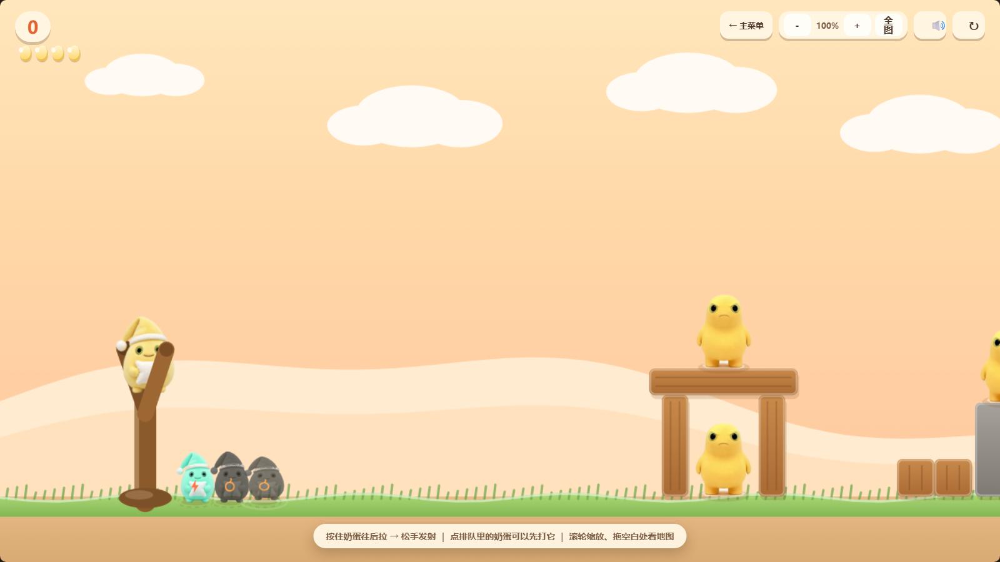
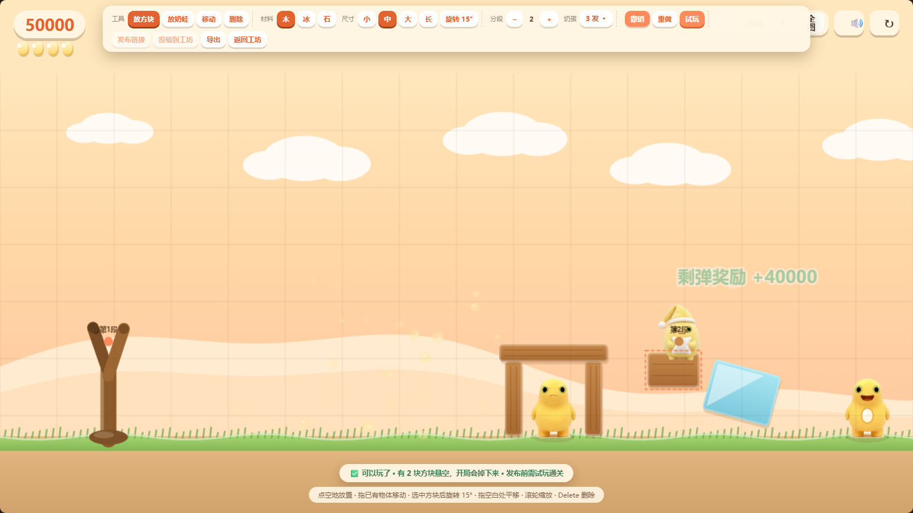
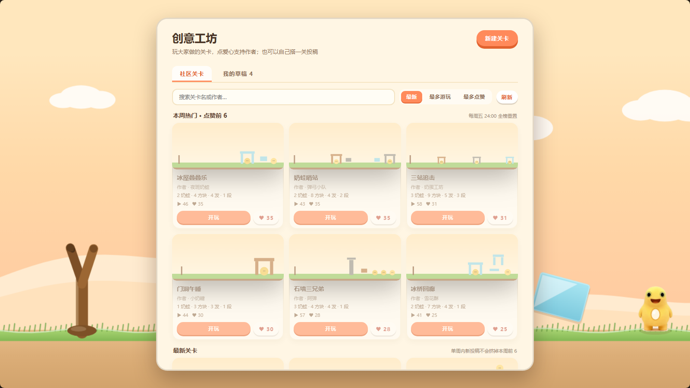
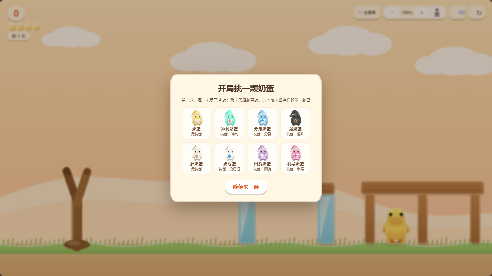
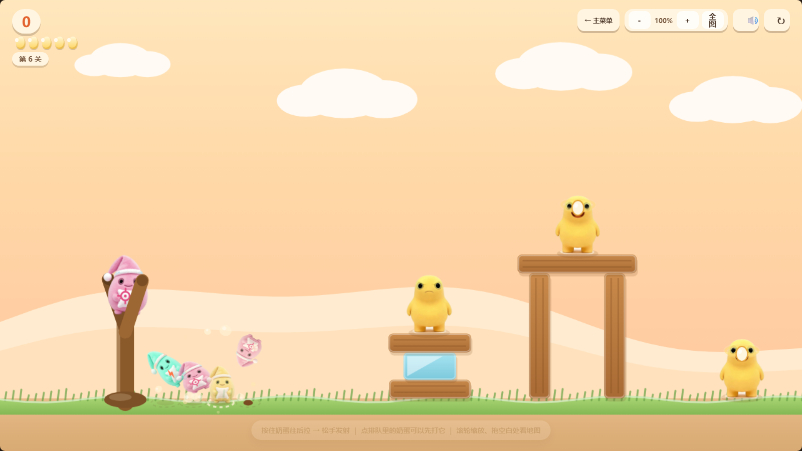
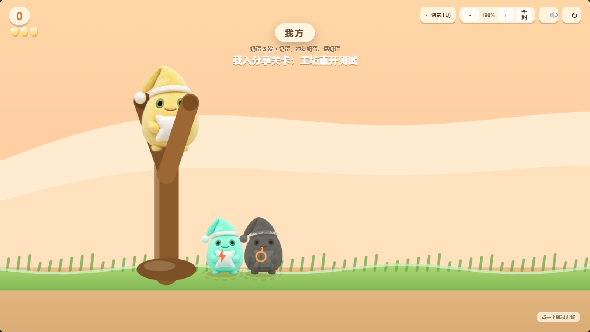
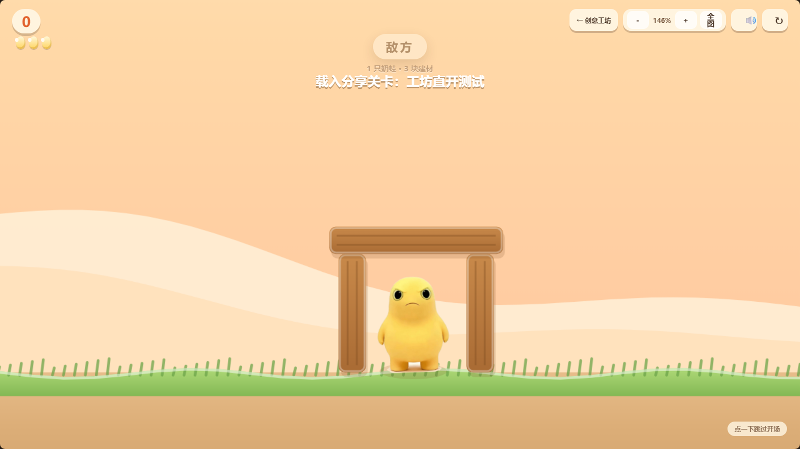
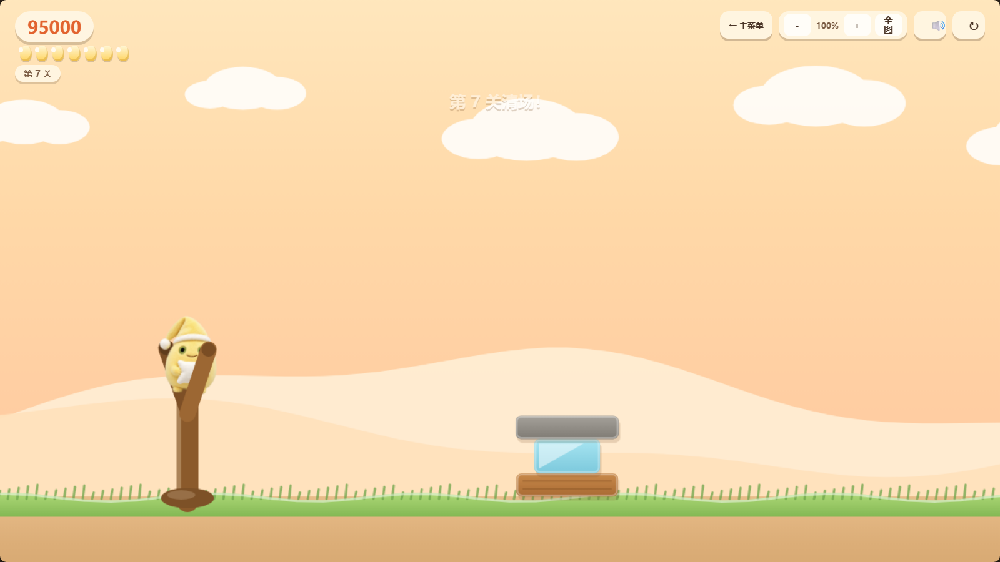
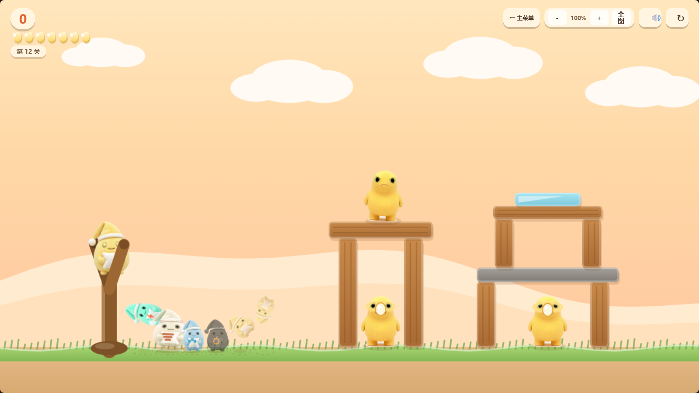

# 奶蛋弹弓

愤怒的小鸟式弹弓游戏：**奶蛋**当小鸟（八个常规形象 + 无尽稀有核爆蛋），**奶蛙**当猪。
纯前端（HTML + Canvas + Matter.js），双击 HTML 就能玩，没有构建步骤，也不需要自建后端。
精选关卡随单文件内联，玩家投稿直接匿名写入 Supabase；点赞/游玩人数用免登录共享计数器。

**在线玩**：<https://busgm666-cloud.github.io/naidan-slingshot/>
**单文件下载**：[dist/奶蛋弹弓-单文件.html](dist/奶蛋弹弓-单文件.html) —— 图片、脚本、物理引擎全内联在一个文件里，双击即玩，也可以直接发给别人。

标题页现在只有两个入口：

- **创意工坊**：自己搭关卡、试玩、改到满意再发布链接；试玩途中可以随时返回编辑器
- **社区关卡**：工坊首页直接浏览大家做的图，带缩略图、作者、点赞和游玩人数，可按最新/最多游玩/最多点赞排序
- **无尽模式**：每关随机生成，越往后奶蛙越多、结构越硬、**地图越长**（分成几段推进），一直打到弹尽粮绝

原来的"第一关"入口已经从标题页移除；那套手工关只留作内部回归场景，不再出现在玩家界面里。

地图是**两倍长**的（2720 起步，随关卡最长长到 4600+），所以镜头能滚、能缩：
滚轮/双指捏合缩放（45% ~ 170%），按住空白处拖动可以左右看地图，右上角有 `－ 100% ＋ 全图` 按钮，
键盘 `+` `-` 微调、`0` 复位、`F` 一键看全图。



## 怎么玩

1. **直接双击** `dist/奶蛋弹弓-单文件.html`（图片、脚本、物理引擎全内联在这一个文件里，可以直接发给别人）
2. 开发用：`npm run dev`（本地静态服务器，默认 <http://127.0.0.1:8848/>）

操作：

- **按住弹弓上的奶蛋往后拉**，出现预测弹道点，**松手发射**
- **拉到最满**（93% 以上）时奶蛋会开始发光、轻微发抖，屏幕边缘泛暖光，力度条变金并打出"满弓！"
  （抖动刻意收细：相机峰值 ±1.3px、奶蛋 ±1.3px，够"绷紧"但不晃眼；蓄力过程是静音的，只在跨过满弓那一刻响一声提示音）
- **飞行中再点一下屏幕**（或按空格）= 放技能，每发只能放一次
- **点排队里的奶蛋** = 让它立刻上弓（悬停会亮圈），想先打哪颗就点哪颗
- **右上角返回按钮**：编辑器试玩回编辑器，社区关卡回创意工坊，无尽模式回主菜单；
  无尽模式退出会暂停当前局面，主菜单上的「继续无尽 · 第 N 关」能原样接着打
- 无尽模式右上角刷新（↻）会先暂停并询问，确认后才清空进度从第 1 关重开；取消则恢复原局面
- **滚轮/双指** 缩放看全图，**按住空白处拖动** 平移镜头（松手自己滑回弹弓）
- 键盘：`空格` 放技能/跳过开场，`+ - 0 F` 缩放，`R` 重开本关，`Enter` 从标题页开始

弹弓右侧排队的奶蛋会 **原地起跳、空中翻一整圈、落地压一下**；每只的周期、高度和翻滚方向都不一样，
轮到谁就先上台，所以队列一直是活的。它们同时也是**按钮**——点一下就能提前上弓。

计分：撞飞一只奶蛙 +5000，砸碎一个方块 +500，**通关时每剩一发奶蛋 +10000**；
结算星星按总分给（≥25000 三星 / ≥18000 两星），所以"省着用奶蛋 + 多拆结构"都值钱。
无尽模式只累计总分，并记录你打到第几关（存在 localStorage 里）。

## 奶龙快跑（跑酷模式）

标题页点「奶龙快跑」，或者直接打开带 `#run` 的链接。奶蛋自动往右跑，越跑越快，一直跑到倒下为止。代码全在 `js/run.js`，跟弹弓玩法互不影响。

- **跳**：空格 / ↑ / W / 点屏幕。空中还能再跳一次（会翻个跟头），按得越久跳得越高
- **滑铲**：↓ / S（手机上是左下角按钮），从吊着的横梁底下钻过去；空中按下 = 急降
- **奶蛙**：从上面踩下去 +100 并弹起来，撞到侧面就倒了
- **木箱**：顶上能站，撞侧面会倒；**坑**：掉下去就倒了
- **奶滴**：每颗 +10 分
- **道具泡泡**（跳起来碰）：冲刺（3 秒无敌飞行）、变胖（6 秒撞碎一切障碍）、奶泡磁铁（8 秒自动吸奶滴）、分身护盾（免死一次）

得分 = 米数 + 奶滴 × 10 + 踩扁 × 100 + 撞碎 × 50，最高分存在 localStorage 里。

## 八个奶蛋

飞行中点一下屏幕就能放技能，左下角会浮出当前这只奶蛋的提示条。

| 形象 | 技能 | 说明 |
| --- | --- | --- |
| 奶蛋 | 无 | 基础款，撞得踏实 |
| 冲刺奶蛋 | **冲刺** | 朝当前方向猛地加速到 26~34 像素/帧，专拆木板和门柱 |
| 分身奶蛋 | **分身** | 一分为三，三只小奶蛋呈 19° 夹角继续飞；单体伤害 ×1.75，三只一起能拆石头 |
| 爆奶蛋 | **爆炸** | 点一下原地炸开（**半径 250、单发能掀掉一整面墙**）；撞上东西也会自动点引信 |
| 胖奶蛋 | 无 | 半径 38（比基础大 30%）、伤害 1.45 倍，一路碾压 |
| 奶泡蛋 | **投奶泡** | 往下丢一颗奶泡炸弹（半径 215 / 伤害 430），自己往上弹一下；奶泡落地即炸 |
| 回旋奶蛋 | **回旋** | 点一下**原地掉头往回飞**（速度不掉还略加，高度压平）；飞过头了可以绕回来打背面 |
| 制导奶蛋 | **制导** | 点屏幕上任意一处，它就**朝那个点直线加速冲过去**（重力压不住这条直线）；点到塔腿、点到奶蛙背后都行，等于"指哪打哪" |

回旋奶蛋的用法是"骗角度"：先让它从目标上方飞过去，在背后点一下，它就会从另一侧砸回来——挡在前面的掩体、boss 塔的背面都能这么打。
另外它给了一个最低回旋速度，所以哪怕撞停在地上，点一下也能重新飞起来。

制导奶蛋的用法是"补角度"：抛物线算不准没关系，飞出去之后直接点你想打的那块砖/那只奶蛙，它会掰直线冲过去，
撞到什么就拆什么（一路上先后撞上的东西都吃满伤害）。它的顶速 30 像素/帧，比冲刺奶蛋（26~34）略低——
它换来的不是蛮力，而是**方向完全由你说了算**：点哪儿算哪儿，全程直线。


## 核爆奶蛋（无尽模式 0.5% 稀有）

- 只会在无尽模式生成关卡时出现：**每一个奶蛋位都独立有 0.5% 概率变成核爆蛋**，
  不会进入标题页角色表、编辑器或开局选蛋。
- 发射约 0.26 秒后自动核爆，按整张地图范围清空所有奶蛙和方块，boss 也会被清掉。
- 不想用可以点等候区把它换下去，留着当后备弹。
- 关卡通关时如果还有核爆蛋没发射，会按数量自动保留到下一关；剩弹奖励不会把这些没消耗的核爆蛋算进去。

## 补给奶蛙

除了 boss，每只奶蛙都有 **25% 概率** 是补给奶蛙：**血量和普通奶蛙完全一样**，但打掉它会**随机补一颗奶蛋**（进队列、弹数 +1，左上角弹数会跟着变）。

外形上一眼能认出来：普通奶蛙是瞪着你的臭脸，补给奶蛙是**咧嘴笑的**，头顶还浮着**金色光环 + 一颗奶蛋**（光环会呼吸、会轻微上下浮）。
它出现的概率由生成种子决定，所以同一关的每一只都是固定的，不会"刷图换怪"。


形象是**程序化生成**的：拿基础奶蛋立绘，把"黄色系"像素在 HSL 里转到目标色相（眼睛、鼻子、手这些深色不动，保留毛绒明暗），
帽子区域单独染色，再在抱枕上贴一个技能胸章（闪电/三点/炸弹/杠铃/水滴）。
生成脚本是 `tools/make-variants.mjs`，改一行就能调出新配色。

## 创意工坊：自己搭关卡

标题页的「创意工坊」按钮就是入口。工坊里可以**新建关卡**，下面是自己搭过的关卡
（自动存在浏览器 localStorage 里，最多 30 份，可以打开、发布或删除）。

### 社区关卡

打开工坊默认就是「社区关卡」页：

- 每张卡直接画一张**真实结构缩略图**，并列出作者、奶蛙数、方块数、奶蛋数和分段数
- 显示 **游玩人数** 和 **点赞数**；点爱心会立刻 +1，再点一次同一颗爱心会取消点赞。
  取消使用独立的“撤回赞”计数器，最终显示的是净点赞数
- **防刷限制**：有效点赞数最多等于游玩数；达到上限后爱心不可再点，
  即使公共计数器被直接刷高，页面展示和周榜也只按“游玩数封顶后的净点赞数”计算
- 点赞/取消点赞会先即时更新按钮和数字，再在后台同步计数器；达到上限时按钮显示灰色禁用态，
  但已经点过赞的关卡仍可再次点击取消
- 支持 **最新 / 最多游玩 / 最多点赞** 三种排序，也能按关卡名或作者搜索
- **每周榜**：每周五 24:00（北京时间）全榜重置，所有关卡重新参与排名；
  单周内点赞前 6 固定在上方，后来的新关卡只进入下方列表，不会把这 6 张挤掉；
  **点赞为 0 的关卡不会进入本周前 6**
- 点「开玩」直接进关，不会弹开局选蛋；关卡阵容就是作者配置的最终阵容
- **关卡名和用户名有内容限制**：辱骂、色情、违法交易/诈骗、手机号、社交账号、邮箱和网址会被拦截；
  编辑器、投稿面板和 Supabase 插入触发器三处都会检查
- 计数走免登录的 Abacus 公共计数器；接口暂时不可用时退回本地缓存，不影响开玩
- 单文件版把社区目录一起内联，`file://` 双击打开也能看到完整列表

投稿不需要 GitHub 或任何玩家账号：通关后点「投稿到工坊」，弹窗会明确标出关卡名和作者署名；
关卡名 1~24 字，署名可留空，填写后就能直接写进
Supabase 的 `workshop_levels` 表，刷新工坊立刻可见。表权限是 **select + insert only**：
匿名玩家能看、能投，不能修改或删除别人的关卡。

Supabase 只需要初始化一次：打开 Dashboard → SQL Editor，整段执行
[`supabase/workshop.sql`](supabase/workshop.sql)。前端使用公开的 Publishable key；
`service_role` / secret key 不会进入网页。

编辑器（全在画布上直接摆，所见即所得）：

- **点空地**放东西；**拖已有物体**挪位置；**拖空白处**平移镜头；滚轮/双指缩放
- 工具：放方块 / 放奶蛙 / 移动 / 删除；方块可选木、冰、石 + 四种尺寸；
  奶蛙可以勾成**补给奶蛙**（打掉补一颗）；选中后按 Delete 删除
- **旋转方块**：选中方块后点“旋转 15°”（Shift 点击为 45°），编辑器里按 `R` 也能转；
  角度会写进分享码、参与物理碰撞，社区缩略图也按真实角度绘制
- **不能堆叠**：方块之间、奶蛙与方块之间都不允许重叠；放置、拖动、旋转时会即时拦截，
  旋转后的方块也按真实角度做碰撞判断
- **分段** 1~3 段（对应三次"推进"）
- **奶蛋阵容**：点"奶蛋"按钮打开阵容面板，8 种奶蛋可以按种类分配数量；
  每种最多 4 发、总数 2~8 发；这里配的就是本关最终阵容，试玩和分享链接都不会再弹开局选蛋
- **关卡名**：编辑器顶部不再占用输入框；点“投稿到工坊”时再填写或修改关卡名，
  投稿成功后会同步更新本地草稿名称
- **撤销 / 重做**（Ctrl+Z / 按钮），每次改动自动存草稿
- **试玩**：一键丢进真引擎跑（不弹选蛋、不放开场，快进快出）；右上角 ✎ 和结算面板都能**回编辑器**，
  回来东西还在，随时继续改
- 实时校验：奶蛙离弹弓太近/太远、插进方块、跑出地图、方块悬空（开局会掉）都会在底部提示，
  有硬错误时"试玩"会变灰，改了就好
- 数量上限：最多 200 方块、40 只奶蛙；达到上限后禁止继续放置并明确提示，
  导入超限关卡时会提示只保留前 200 方块和 40 只奶蛙
- **发布门禁**：必须先完整试玩通关一次，"发布链接"才会解锁；改关卡名、方块、奶蛙或奶蛋阵容后，
  发布资格立即失效，要再通关一次（分享码就是这版关卡的指纹）
- **发布**：把关卡压成一段短码塞进链接（`#level=…`，一段 4 个方块 2 只蛙的关卡约 260 字符），
  复制发给谁、谁打开就直接进这一关。`https` 下走剪贴板；`file://` 没有剪贴板权限，会帮你把链接选中，按 Ctrl+C 即可
- **导入 / 导出**：导出是带 `formatVersion` 的 JSON 文件；导入既认 JSON 文件，也认直接粘分享码

目前的边界：Supabase 负责投稿目录，Abacus 负责点赞/游玩人数；
两者都是公共接口，适合展示人气，但没有账号级防刷和举报后台。





## 无尽模式的开局选蛋：多带一颗，一局只挑一次

开一局无尽模式的时候先弹一个面板：**8 个奶蛋里挑一颗**，它插在队首**首发**。
这一局之后每一关都自动多带一颗**它**，不再问你——多带的那颗挂在**队尾当备用弹**
（所以每关的奶蛋数 = 原本的数量 + 1：无尽第 1 关 3 → **4 发**，第 2 关 3 → 4 发，boss 关 8 → 9 发）。

- 面板上直接写着第 1 关总共几发，左上角弹药图标画的也是 +1 之后的数字
- 懒得挑就点「随便来一颗」；在面板上乱点画布、按空格都不会把它跳过
- 重开一局（`R`、右上角 ↻、结算面板的"再来一次"）会重新问一次
- 自动验收/调试不弹面板也不记选择（`window.__nai.pick()` 可以手动点一下）



## 点等候区的奶蛋：点谁谁先上弓

弹弓脚边排队的那一排奶蛋**是可以点的**（鼠标悬上去会亮起虚线圈、光标变手型）：
点哪一颗，它**立刻上弓**，原来架上那颗退回队列里刚好空出来的格子——名额和顺序都不变，只是快了一手。
临时想换颗爆奶蛋去拆墙、或者想把回旋留到最后一发，点一下就行。

飞行中不画排队区，所以那会儿点屏幕还是**放技能**，两个操作不会打架。



## 开场动画

每次开一关（含无尽模式的每一关）都会先放一段"左右移动展示双方"的开场：

1. 镜头拉近到弹弓（1.9 倍），打上 **我方** 标签，列出这一关的奶蛋阵容
2. 平移到结构一侧（自动选景别：短关卡 1.5 倍，长关卡一直缩到能装下整张地图），打上 **敌方** 标签，
   列出奶蛙数量、建材数量和分段数
3. 拉远回到全景，进入瞄准状态

整体 4.9 秒起，**关卡地图越长推镜越久**（最长约 7 秒）；无尽模式压缩到 66%。**点一下或按空格随时跳过**。




## 无尽模式：每关随机生成

关卡由 **9 个手工对齐过的建筑预制件** 拼出来（其中 3 种是多层房子），随机部分包括：挑哪几个预制件、用哪几种材料（木/冰/石）、奶蛙站哪、
奶蛋阵容、以及整体错位。预制件本身是严丝合缝的，所以"随机"不等于"会自己塌"。

**地图长度靠"多分段"来涨，不靠把奶蛙摆远**——每段都是一个紧凑的小战场：

| 关卡 | 1 | 4 | 7 | 13 | 20 | 26 |
| --- | --- | --- | --- | --- | --- | --- |
| 分段数（波次） | 1 | 2 | 3 | 3 | 3 | 3 |
| 地图长度 | 2200 | 3176 | 4702 | 4720 | 4720 | 4720 |
| 奶蛙 | 2 | 4 | 5 | 8 | 9 | **12** |
| 方块 | 9 | 11 | 15 | 21 | 24 | **38** |
| 方块血量倍率 | ×1 | ×1 | ×1 | ×1.05 | ×1.4 | **×1.7** |
| 奶蛋（生成） | 3 | 4 | 5 | 7 | 8 | 8 |
| 奶蛋（实际，开局选蛋 +1） | 4 | 5 | 6 | 8 | 9 | 9 |

**波次最多 3 波**（每波就是一次"推进"）。3 波用满之后，难度不再加段落，而是**堆在单波次里**：
更多奶蛙（第 7 关一关 5 只 → 第 26 关 12 只）、更厚的方块（第 12 关之后每关 +5% 血量，最高 ×2.2）。

每段的生成带固定在"这一段弹弓往前 420~1360px"（满力 45° 大概能飞 2100~2300px，余量很足），
预制件之间的间隔也压到 40~90px，所以**地图长但不散**：走位是一段一段推进的，
不会出现"为了把地图拉长，把奶蛙丢到半个屏幕外"的情况。自动验收里也卡了这条（最远 1500px）。

**清完一段，弹弓连同待发的奶蛋一起往前推到下一段**，镜头跟着平移过去，剩几发奶蛋一路带到结束。
（boss 关也是这个机制：门口那波前哨清完，弹弓就推进到塔前那一段。）



## BOSS 关：每 10 关来一位「奶皇」

第 10、20、30 关分两段打：**先在门口清一波"前哨"**（1~2 只奶蛙守着一间小屋），弹弓推进到塔前，
才是 boss 战。形象用的是**正面抱臂的胖奶蛙**（做成透明立绘，另外生成了一张"张嘴大笑"的变体专门给死亡演出用），
名字叫**奶皇**，蹲在一栋**可拆的阶梯塔**顶上。

前哨是刻意做轻的（就一块预制件），它的作用是**给 boss 战垫一段"接近"的节奏**：先用一两发摸掉门口的守卫，
推进过去，再面对那栋塔。推进点严格按"离塔 714px"摆，所以第 2 段的对射距离跟单段版本一模一样。


### 怎么打：摔伤是主要解法

直接怼它是有折扣的（伤害 ×0.5 / ×0.46 / ×0.42），**爆炸也有折扣**（×0.28 / ×0.26 / ×0.24，不然"开局选蛋"里
带一颗爆奶蛋贴身炸一下就能打掉它一大截），真正掉血的是**让它摔**：

| 打法 | 一次造成 | 占满血比例 |
| --- | --- | --- |
| 打断塔腿，让整层塌下来 | 260~490 | **27~50%** |
| 爆奶蛋贴在它身上炸 | 157 | 11% |
| 一发满力直怼（落它身上、不碰塔） | 60~115 | 6~12% |

**塌方是直怼的 3~5 倍**，所以打法就是：把塔当武器。塔有两到三层，腿一发就能断——**先打断底层腿**（整座塔塌下来，
两层楼板连着砸，这是最大的一击），**再打上层腿**（第二次塌方），最后平射补刀。
爆奶蛋的好用法也是"炸腿"：它自己伤得不多，但能一次性掀掉一层。
难度不在瞄准（实测 2°~20° 的平射都能打断腿，窗口很宽），而在**弹药账**：它每 3 发回 25% 血，
光靠平射是永远磨不完的。

### 它也会还手：每 3 发喊一个帮手 + 回 25% 血

奶皇不是站着挨打的：**你每打出去 3 发奶蛋，它就召唤一只奶蛙站到塔前，并回复 25% 血**
（560 / 760 / 940 三档分别回 140 / 190 / 235，回血封顶在满血）。

- 召唤来的奶蛙**正好站在你和塔之间**：平射会被它吃掉，等于逼你换角度、或者干脆先把塔拆了——
  塔塌下来会顺手把它压在下面
- 它们是"boss 那一段"的奶蛙，**不清掉就通不了关**
- 所以正确节奏是"**别磨**：塌方之后两发内补掉"。实测会打腿的玩家 2 / 5 / 8 发就收工（第 10 / 20 / 30 关）；
  反过来一发一发慢慢怼，伤害会被 25% 的回血吃掉，越拖越难打
- 第一次触发会弹一条提示把规则说清楚，**之后不再刷字**：回血只让血条往回跳一下 + 冒一层绿光，
  召唤就是"一道召唤波 + 一只奶蛙落下来"，不写"回血 +140 / 护卫 +1"这种说明字幕


### 压迫感从哪来

- 场地切成**黄昏血色调**：暗紫天空、暗红远山、深色地面，外加常驻四角压暗，还隔几秒打一道闪电（配雷声）
- boss 关**开头有一段特写**：镜头猛推近到 2.35 倍，四周放射黑线，红色 `BOSS` 标签砸下来，配一声低吼
- 头顶一条**血条**（放在 DOM 上，所以缩到 45% 看全图时它也清清楚楚），被打中会闪一下


### 数值与容错

| 档位 | 出现 | 血量 | 塔层 | 前哨 | 奶蛋 | 技能（每 3 发） | 直怼系数 | 爆炸系数 | 摔伤系数 |
| --- | --- | --- | --- | --- | --- | --- | --- | --- | --- |
| Lv1 | 第 10 关 | 980 | 2 层 | 1~2 只 | 9 发 | 召唤 + 回 245 | ×0.5 | ×0.28 | ×77 |
| Lv2 | 第 20 关 | 1050 | 3 层 | 1~2 只 | 9 发 | 召唤 + 回 262 | ×0.46 | ×0.26 | ×80 |
| Lv3 | 第 30 关 | 1120 | 3 层 | 1~2 只 | 10 发 | 召唤 + 回 280（一次喊两只） | ×0.42 | ×0.24 | ×84 |

血量是照"打得完、但必须打满"反推的。两条约束：**塌方是主要武器**（整座塔塌下来实测能砸 260~490 血，
所以血量要抬到"一次整层塌只占两三成，但仍是直怼的 3~4 倍"），以及**它每 3 发回 25% 血**
（相当于总伤害预算得是血量的 1.5~1.75 倍 —— 只靠平射直怼是打不完的，必须把塔拆下来砸它）。
实测（正规打法：打断底层腿 → 再打上层腿 → 平射补刀）：第 10 关约 4 发收工，每关大约触发 1~2 次召唤；
高两档要 6~9 发，而且塌方会把 boss 推到别的位置——它滚开了就得重新算角度（实测塔倒之后它会滚到 1841，平射 10° 会从它头顶飞过去，得压低一点打）。

容错做了三层：**奶蛋给到 10~11 发**（普通关只有 3~6 发；加上开局选蛋那颗是 11~12 发。其中 1~2 发会花在门口那波前哨上，
所以真正的 boss 战弹数跟以前差不多）、**一次整层塌就掉 6 成血**、
**打不过还给一次重打机会**——弹尽粮绝时不会直接结束整局，而是弹一个「奶皇还站着…」的面板，
点"再打一次"会**用同一份关卡数据重建**（布局一模一样：前哨、boss 血量和奶蛋全都补满，分数退回进关时的那份）。
第二次再失败才真的结束无尽模式。

### 死法

打赢的那一刻它不会普通地"飞出去"，而是**仰天大笑、翻着、慢悠悠飞出画面**：全屏彩带 + 奶油粒子 + `BOSS +30000`，
镜头跟着它平移一段，配一声**奶蛙大笑**——这是全项目唯一的真实音频素材
（`assets/boss_laugh.mp3`，3 秒，用 `tools/make-boss-laugh.mjs` 从原始音乐里裁的；
其余音效全是 WebAudio 现场合成的）。万一这素材没加载好或者处于静音，会自动退回合成的"长笑 + 奶蛙起哄"。


| 预制件 | 占地宽度 | 长相 |
| --- | --- | --- |
| 门洞小屋 | 190 | 两根柱子一根梁，梁下蹲着一只 |
| 叠叠塔 | 150 | 木板 + 冰砖 + 木板，顶上坐一只 |
| 三柱大棚 | 320 | 三根细柱撑着大屋顶，里面两只 |
| 大石头 | 150 | 一块大石头，顶上蹲一只，前面还有木箱 |
| 瞭望台 | 190 | 两根高柱撑平台，最顶上一只 |
| 牛奶桥 | 250 | 两墩冰柱撑长板，板上板下都有奶蛙 |
| **双层小楼** | 240 | 一楼一只、二楼一只；最高档还会加个阁楼，变成三只 |
| **三层塔楼** | 200 | 三层收窄的塔，每层塞一只 |
| **阶梯顶小屋** | 260 | 一楼 + 二楼 + 两级收窄的屋顶，两只奶蛙 |

多层房子适合"拆楼"：打断楼下那层，整栋会往下坐，二层那只跟着摔。


难度按关卡爬：材料档位（木冰 → 加石头 → 更多石头）、奶蛙数量（2 → 7）、奶蛋数量（生成 3 → 6，加上开局选蛋那颗是 4 → 7）。

| 关卡 | 1 | 2 | 3 | 4 | 5 | 6 | 7 | 8 | 10 |
| --- | --- | --- | --- | --- | --- | --- | --- | --- | --- |
| 奶蛙 | 2 | 3 | 3 | 4 | 4 | 5 | 5 | 6 | 1~2 + 奶皇 |
| 奶蛋（实际） | 4 | 4 | 4 | 5 | 5 | 5 | 6 | 6 | 11 |

同一局的种子固定，所以同一局的第 N 关每次都长一样（方便复现问题和写测试）；开了新一局才换种子。



生成器有一道**落位校验**：任何奶蛙在出生前都要检查"会不会跟方块或别的奶蛙重叠、会不会出界"，
重叠就换到结构前后的空地，实在放不下就不放。没有这道校验时，补位的奶蛙会被塞进房子内部、
把结构当场顶散——这是自动验收抓出来的真 bug。

## 素材来源

这个形象族群的背景：**奶龙**是官方角色，**奶蛙**是它的民间 AI 变异体（黄圆润、浅米腹、绿眼、灰爪），
**奶蛋**是同一族群里的毛绒蛋形象（戴睡帽、抱抱枕）。

| 素材 | 来源 | 说明 |
| --- | --- | --- |
| 奶蛙立绘（气鼓鼓／露齿大笑／蹲坐托腮） | [Nailong-Studio/wallpaper](https://github.com/Nailong-Studio/wallpaper)（奶蛙艺术圣殿素材仓） | 白底工作室立绘，原图在 `emotes/` |
| 奶蛋桌宠切图（睁眼／眨眼／转头） | [trixster2/nai-dan-pet](https://github.com/trixster2/nai-dan-pet) | 毛绒玩具照片抠出来的透明 PNG |
| 奶蛋衍生作品（仅参考） | [Pa1eCr0w/naidan-deadlock-mod](https://github.com/Pa1eCr0w/naidan-deadlock-mod)、[liuchenwei285/naidan-desktop-pet](https://github.com/liuchenwei285/naidan-desktop-pet)、[NaiFrog-Fan/NaiEgg](https://github.com/NaiFrog-Fan/NaiEgg) | 另一路奶蛋二创，本轮没直接用 |
| 素材镜像 | jsDelivr CDN（`cdn.jsdelivr.net/gh/...`） | 本机直连 raw.githubusercontent 会被卡住，走 CDN 才拉得下来 |

原始图不入库（在本地 `art-source/`，`.gitignore` 已排除），处理脚本 `tools/prepare-assets.mjs` 负责：
白底立绘按"亮度 + 黄色分量"洪水填充抠图（不然会把奶白色帽檐和抱枕抠穿）、洗掉摄影棚地面投影、
透明区溢色防白边、调色板压缩（体积降到 1/5）。

## 版权与声明

- 这是个**非商业的同人练手项目**，不上架、不收费、无广告。
- **代码**（`js/`、`tools/`、`index.html` 等）按 [MIT](LICENSE) 授权，随便看、随便改；
  素材条款单独写在 [NOTICE](NOTICE) 里（MIT 只覆盖代码）。
- **角色美术不在授权范围内**：奶龙是官方角色，奶蛙属民间 AI 二创，本项目里的立绘来自上表那些
  GitHub 仓库，只在本项目里作为同人素材使用；版权归原作者。要商业化发行，必须换成自有美术或拿到授权。
- 如果你认为这里的素材侵犯了你的权益，开个 issue 或邮件说明，我会**立刻下架**对应素材。

## 工程结构

```
奶蛋弹弓/
├─ index.html                 开发版入口（外链 assets/ 和 js/）
├─ dist/奶蛋弹弓-单文件.html    打包产物，双击即玩（约 1.1 MB）
├─ js/
│  ├─ game.js                 主逻辑：物理、伤害、回合、技能、开场动画、镜头、渲染
│  ├─ birds.js                八个奶蛋的档案（外形/物理/技能）
│  ├─ levels.js               第一关 + 无尽模式生成器（预制件 + 落位校验）
│  ├─ workshop.js             创意工坊的数据层（关卡归一化/校验/分享码/JSON）
│  ├─ community.js            社区目录读取 + 匿名投稿 + 共享点赞/游玩计数
│  ├─ moderation.js           关卡名/用户名违禁词与广告联系方式过滤
│  └─ audio.js                程序化音效（WebAudio 合成，不用任何音频文件）
├─ assets/                    处理好的游戏素材（基础奶蛋 + 5 个衍生形象 + 奶蛙）
├─ art-source/                联网扒到的原始图（extra/ 是没用上的备选）
├─ vendor/matter.min.js       物理引擎（Matter.js 0.20）
├─ supabase/workshop.sql      投稿表、RLS 与匿名读写权限
├─ workshop/                  静态精选目录（JSON + 单文件用 JS 数据）
├─ tools/
│  ├─ prepare-assets.mjs      素材处理（抠图/清底/压缩）
│  ├─ make-variants.mjs       生成 5 个新奶蛋形象（配色 + 帽子 + 胸章）
│  ├─ make-boss.mjs           boss 立绘：手机截图自动裁图去黑边 + 白底抠图 + 生成大笑变体
│  ├─ build-single.mjs        打包单文件 HTML
│  ├─ build-workshop-seed.mjs 生成首批社区关卡目录
│  ├─ verify.mjs              Playwright 自动化验收（截图 + 断言）
│  ├─ smoke.mjs               快速冒烟 + 宣传图（intro / skills / endless / showcase）
│  ├─ check-prefabs.mjs       建筑预制件几何自检（重叠 / 悬空 / 奶蛙插进方块）
│  ├─ debug-alpha.mjs         alpha 通道可视化，肉眼看抠图残留
│  └─ serve.mjs               本地静态服务器
└─ shots/                     验收截图与报告（verify-report.json）
```

命令：

```bash
npm run dev        # 本地起服务
npm run assets     # 重新处理素材（改了 art-source 之后跑）
npm run variants   # 重新生成 5 个衍生奶蛋形象
npm run boss-art   # 重新处理 boss 立绘（换图时跑）
npm run boss-laugh # 重新裁 boss 笑声（换音频时跑，需要 ffmpeg-static）
npm run check      # 预制件几何自检（改结构之后先跑这个）
npm run build      # 出单文件版
npm run workshop-seed # 重新生成首批社区关卡目录
npm run verify     # 全套自动验收（约 2 分钟）
node tools/smoke.mjs showcase   # 只抓几张过程图
```

## 自动验收（`npm run verify`）

用本机已装的 Chrome 跑（不需要下载浏览器），当前全绿：

1. 十一个素材全部加载，标题页 8 个奶蛋角色卡都渲染出来
2. 地图长度是 2720（原来 1360 的两倍），缩放范围 45%~170% 都能生效、`100%` 能复位
3. 开场动画：起始是"我方"近景，切到"敌方"并把镜头移过去，跳过能干净地回到瞄准状态（镜头回到 1.0 倍）
4. **开局选蛋**：点"无尽模式"要先弹面板（8 张卡）、面板上写清这一关总共几发（3 发原始阵容 +1 = 4）；
   点第 4 张卡之后首发必须变成爆奶蛋、这一关阵容 `[爆奶蛋, 奶蛋, 冲刺, 爆奶蛋]`、弹药显示 4；
   选蛋面板会拦截画布、缩放/重开按钮和键盘快捷键，点面板外/按空格/R 都不能穿透；**一局只问这一次**：无尽模式清场进第 2 关不许再弹面板、
   但第 2 关照样是"原本 3 发 +1 = 4 发"、首发还是关卡原本那颗、开局挑的爆奶蛋挂在队尾；
   调试跳关（`loadEndless`）不弹面板但也 +1（第 1 关 4 发、boss 关 11 发）。
   **创意工坊例外**：试玩和分享链接都不弹开局选蛋，奶蛋数严格等于作者配置的阵容数量
5. **点等候区的奶蛋**：鼠标悬上去要认出是哪一颗（`queueHover`）并把光标变成手型；
   点第 3 颗之后它必须**立刻上弓**（`currentBird` 变成它），原来架上那颗退回队列的同一格子，
   弹药数和这一关的阵容都不许变
6. 第一关开局 2.4 秒内结构自身位移不超过 5px，而且不能有方块自己碎掉（防止预制件悬空）
7. 8 个角度扫射（含远距离大弧线），至少 4 个角度有击杀（当前 6/8），且至少能打碎方块
8. 存在两发通关的线路（当前 0°+14° = 35500 分，刚好压过三星线）
9. 三发真打空（往天上射）能正常判负
10. **物块摔落伤害**：木块从 60px 摔下来掉血 ≤15%、从 320px 掉血 ≥50%（实测 6% / 76%），冰块从 320px 必碎
11. **满弓力量特效**：鼠标真的拖到最满时 power ≥0.95 且 charge ≥0.6（特效确实亮起来了）
12. **等候区待机动作**：连续采样 3 秒，姿态种类要够多、最高点抬升 >18px、至少要翻过 90°
13. **八个奶蛋逐个进沙盒试技能**：冲刺要变快、分身要变 3 只、爆炸要真炸掉方块且出冲击波、投奶泡要生成并炸掉奶泡炸弹、回旋要真的掉头往回飞、制导要真的朝点击的位置直线飞，另外两只要明确没有技能
14. **技能强度**：奶泡炸弹必须真炸掉方块（当前 2 块）；分身三只一起至少拆 3 块
15. **制导奶蛋**：点一个指定的位置之后，方向必须和"点到那个位置的方向"一致（误差 <0.02）、
    制导期间**必须是一条直线**（实测最大偏移 0.8px）、加速到 26 像素/帧以上、点击处留下靶心标记
16. **落地之后不许打转**：朝地面打一发，全程角速度峰值 ≤0.3 弧度/帧、**滚停下来之后角速度必须≈0**
    （实测峰值 0.036、静止时 0.003；修之前峰值 0.4 并且落地后长时间停不下来）
17. **清障穿透**：密集横排墙上，奶蛋一发至少连拆 2 块、胖奶蛋一发清掉 3 块
18. **补给奶蛙**：40 关 × 5 种子的出现率要落在 18%~32%（实测 24.9%），打掉之后弹数要按数量 +1
19. **波次规则**：所有关卡波次 ≤3、高关卡用满 3 波；第 26 关的奶蛙数与方块血量倍率都要高于第 7 关
20. **无尽随机生成稳定性**：2 个种子 × 10 个关卡（1~12），每关等 2.2 秒，位移必须小于 8px（当前最大 5.1px）
21. 地图随难度变长、每只奶蛙离它那一段弹弓都不超过 1500px（当前最远 1181px，不会为了拉长地图把奶蛙摆远）
22. **分段推进**：清完一段弹弓往前推、镜头跟过去、剩几发奶蛋继续用；推进的瞬间刚好弹尽也不能卡死（判负或判胜）
23. **先清后段也能正常结算**：两段关卡里先把**最后一段**的奶蛙全清掉（不该推进）→ 再清当前这一段 →
    **一弹不发**，游戏必须自己结算（实测 `state=clearing, 场上奶蛙 0`）。
    老代码在"这一段清完"时无条件推进到 `stageIndex+1`，于是把弹弓推到一个空段上，玩家得再补一发才结束
24. **转波次不会反向发射**：清掉这一段后的 0.95 秒里就开始拉弓、一直按到弹弓推进到下一段之后才松手，
    这一下**不许发射**（残留的拖拽必须作废、`pullPower` 回 0，奶蛋老老实实待在弓上）。
    以前这一下会拿"上一段的拉弓位置"去减"新弹弓位置"，算出个反向的巨大拉力，奶蛋直接从新弹弓位置倒着甩出去
25. **爆奶蛋点屏引爆 + 转波次**：把队里的爆奶蛋点上来当首发 → 打出去 → 飞一半**点屏幕引爆**，同时清掉这一段
    （最糟的撞车姿势）。之后只允许场上留一颗"没发射的蛋"、而且它必须在弹弓上；
    以前这种情况会留下一颗蛋**卡在引爆时点到的位置**（静态刚体不会掉、也没人回收），
    下一颗还会拿它残留的拉弓位置去算拉力
26. **BOSS 关**：第 10/20/30 关必须生成 boss（血量随档位递增）、非整十关不许有；开场必须有 BOSS 特写标签且镜头推到 2 倍以上；血条要显示并跟着掉血
27. **boss 关多一波前哨**：boss 关必须是 2 段（`launchPoints` 两个推进点），boss 只站在**最后一段**、
    前哨 1~2 只奶蛙；按正常流程清掉前哨要能推进到第 2 段、boss 还在原地、
    **推进后离 boss 的距离不能变**（905px，跟单段版本一致，不能让"多一波"顺手把 boss 战变简单）
28. **boss 的技能**：前 2 发不召唤、**第 3 发必召唤**：场上奶蛙 +1、回血正好是满血的 25%（实测 100 → 240）、
    召唤来的奶蛙必须站在塔前那片空地（实测 x=1820、y=600，离 boss 一百多像素，出生不被压伤）、
    而且算在 boss 那一段（不清掉通关不了）；快满血时回血要**封顶**（559 → 560，不溢出）；第 6 发召唤第 2 只
29. **摔伤是主要解法**：一发整塔塌方 260~490 血、是直怼（60~115）的 3~5 倍，且单次塌方要占满血 25% 以上；
    另外**爆炸不能绕过 boss 的减伤**：贴身炸只有 157 血（×0.28），远低于一次塌方。
    （"直怼"那一发刻意挑 30°：25° 那种擦边角度会随 boss 落座时的几像素偏移变成"顺手打断塔腿"，同一发弹药能打出 165~560 血）
30. **boss 笑声素材**：页面加载完必须真的把 `boss_laugh.mp3` 读进来（`readyState ≥ 2`，实测 4）；
    击杀 boss 时要真的播出去（实测 `attempts 1 / plays 1`，不是只"尝试了一下"）
31. **boss 死亡与容错**：击杀要加 30000 分；打不过必须给一次重打机会（血量/奶蛋重置、分数退回进关时，
    而且重打要**从前哨那一段重新开始**），第二次失败才结束整局
32. 无尽推进：连清三关会进第 4 关、分数累计、弹尽粮绝会结算
33. 源码版和单文件版用 `file://` 直接打开都正常（都能进标题页、打开创意工坊并进入游戏）
34. **创意工坊**：标题页必须是"创意工坊 + 无尽模式"（不再有"第一关"按钮）；
    新建关卡的默认关（3 方块 1 蛙）校验零错误；点空地能放方块/奶蛙、拖动能挪位置、拖空白能平移镜头；
    撤销/重做、改分段数、按种类配奶蛋阵容（例如 2 爆 + 1 基础）、分享码来回解（260 字符左右、解出来一致）、
    方块旋转 15° 能生效并随分享码往返，390px 手机视口出现足够大的浮动旋转按钮；
    390px 手机端社区为两列、卡片宽 ≤190px，编辑器工具栏单行横向滑动；
    关卡名输入只在投稿弹窗出现，改名校验和投稿后草稿同步都要生效；
    重叠位置禁止放方块/奶蛙，拖动或旋转造成重叠会退回；
    试玩进的是 `mode=custom` 且方块/奶蛙数与编辑器一致、HUD 的“← 编辑器”能中途回编辑器、
    两段清完能结算、结算面板有"回编辑器"且回来东西还在；
    **发布门禁**：没通关不能发布，通关后能发布，改动任意关卡内容后立即重新上锁；
    数量上限：200 方块/40 奶蛙时继续点击放置不增加对象，并显示"已达上限"提示
35. **社区工坊**：目录至少 6 张图全部能解出来；卡片数、作者和多维信息正确；
    搜索“冰屋”只剩 1 张；最多游玩/最多点赞排序生效；点赞 +1 并记住本机已赞；
    再点同一颗爱心会取消点赞并恢复净点赞数；投稿弹窗必须显示关卡名/署名长度提示；
    模拟“9 赞 / 5 游玩”时有效赞数必须封顶为 5，爱心禁用并提示先玩一次；
    已赞关卡处于上限时仍可取消，按钮即时变回未赞且净赞数立即减一；
    本周点赞前 6 单独锁定，周五 24:00 北京时间边界换榜，新投稿只进下方列表；
    0 赞关卡不得进入本周前 6；
    从卡片开玩会记录游玩人数、直接进自制关卡且不弹选蛋；投稿面板能匿名插入 Supabase 并立刻刷新目录；
    违禁关卡名会禁用试玩/发布，违禁用户名会拦住投稿，分隔符绕写和广告联系方式也要识别；
    源码版和单文件版的 `file://` 直开都能加载完整社区目录
36. **返回与无尽续关**：社区关卡 HUD 显示"← 创意工坊"并能回到工坊；编辑器试玩显示"← 编辑器"；
    无尽模式飞行途中退出会冻结局面，主菜单显示当前关卡号，继续后奶蛋从退出位置接着飞、弹药数和关卡号不变
37. **无尽刷新确认**：第 5 关点右上角刷新只弹确认框、不清进度；取消回到第 5 关原局面；
    确认后才从第 1 关重开
38. **核爆奶蛋**：每个奶蛋位独立 0.5% 概率，固定种子 17 能命中；它不能出现在编辑器/开局选蛋/标题页；
    未发射时能从第 1 关保留到第 2 关，发射后场上奶蛙和方块都清零

验收脚本发射前会等物理真正静止（`maxSpeed` 归零）再开火：物理本身是确定的，
但"重开后固定等 300ms"这种时机不确定，会让同一个角度两次结果不同。

这套验收加上 `npm run check` 一共抓出过六个真 bug：底部奶蛙被根本没碰到的横梁误判成"被压死"、
重开后上一关的定时器打乱下一关流程、随机关卡把补位奶蛙生成在结构内部导致房子当场散架、
换关时上一发的奶蛋还留在"飞行中"名单里画出一只幽灵奶蛋、
叠叠塔第三档的冰砖悬空了 41px（开局自己掉下来）、以及 `sort(() => R() - 0.5)` 这种随机比较器
让 Node 和浏览器生成的关卡不一致（现在换成 Fisher-Yates，两边结果完全对得上）。

后来又补上一条**"奶蛋掉在拉弓的位置上 / 反向发射"**，根因有两层：

1. **松手那一下自己另算一遍拉力**。拖动时把拉弓位置夹取到 `MAX_PULL`、只准往左后方拉，松手时却直接
   `新弹弓位置 - 旧拉弓位置`：转波次会把弹弓整根挪走，于是算出个反向的巨大拉力，奶蛋倒着甩出去
   （实测 vx 冲到 160 像素/帧；`activeBird` 为空时还会直接抛异常）。现在拖动和松手共用同一份夹取计算。
2. **延迟结算回调会打到下一回合**。奶蛙倒下后有个"等 0.95 秒再结算"的回调，它只看状态是不是 title/over——
   可这 0.95 秒里回合常常早就结束了（奶蛋自己停下来 → 结算 → 推进到下一段），回调却照样补一发 `endShot()`：
   把下一段的瞄准硬生生打断（正在拉弓的手被作废、刚上弓的奶蛋被收走又换一颗 = **白白少吃一颗**），
   清场时还会重复结算。而且奶蛋每一帧都是被"摆在拉弓位置上"的，光把拖拽引用清掉不清位置，
   它就会**永远卡在玩家拉弓/点屏的那一点上**（静态刚体不会掉下来）——这就是"奶蛋掉在拉弓的点击位置"。
   现在每一发自增一个 `roundToken`，延迟回调只认自己那一发；丢拉弓一律走 `dropDrag()`（把奶蛋放回弹弓）；
   系统取消手势（`pointercancel`）按"作废"处理，不再替玩家开火。

3. **修 #1 时顺手引入、又被验收抓回来的**：为了不让"没发射的奶蛋"漏在场上，我在 `endShot()` 里加了一句
   `if (used && !used.game.launched) removeBird(used)`。可"转波次打断拉弓"时 `activeBird` 正是**玩家手里那颗没发射的**，
   于是它被直接删掉、下一颗从队列顶上——玩家看到的就是"**转轮次时弓上那颗凭空消失**"，而且白吃一颗奶蛋。
   现在：`endShot()` 不再动这颗；`loadBird()` 发现弓上已经有一颗没发射的就**留着它**（不换弹）；
   `advanceStage()` 把它一起挪到新弹弓上。验收里卡了三条：手里那颗的类型不变、弓上+队列的总数不变（补给奶蛙的 +1 单独算）、
   弹药数不变。

另外，把地图加长到两倍之后第一关原来是"靠着右边墙就在奶蛙旁边"才成立的——墙挪远了，原来那条 28° 的线路直接失效。
所以第一关重做成了**双营地**：近处一个矮门洞（两个奶蛙），远处一块大石头顶着一只。
远营地必须靠大弧线越过门洞才够得着，于是"省一发奶蛋"就变成了"会不会算抛物线"。

## 实现要点

- **物理**：Matter.js，固定 60Hz 步进。方块是矩形，奶蛙和奶蛋是圆，静态地面加左右墙。
- **伤害模型**：碰撞时取相对速度与另一方质量算动能，`伤害 = (动能 - 阈值) × 系数`，再乘材质系数
  （冰 2.4 倍脆、石头 0.62 倍抗）；奶蛙另有"重物砸落"加成和"被压住持续掉血"。
  爆炸按 `伤害 × (1 - 距离/半径)^1.3` 衰减，保证边缘也真能拆东西；对 boss 另外乘一个爆炸折扣，
  所以"带爆奶蛋开局秒 boss"这条捷径是不通的。
- **拆障碍物**：奶蛋撞方块另有 ×1.35 的"清障加成"（打奶蛙不加，避免顺手改掉关卡手感），
  并且**撞碎一块之后保留 86% 速度**，所以一发能连着拆穿 2~4 块（上限 3 次）；
  各形象的 `damage` 倍率也终于接上了：胖奶蛋 ×1.45（连大方石都是一发碎）、分身小奶蛋 ×1.75、
  石头从"3~4 发"调到"细柱一发、大方块两发"。
- **物块也会摔伤**：方块在下坠中撞到任何东西都按"自身质量 × 下坠速度"算动能（再 ×2.4），
  所以塌方会一路碎下来。同一块 90x60 木头实测：落差 60px 掉 6%、180px 掉 43%、320px 掉 76%、520px 直接碎；
  冰块从 320px 摔下来必碎。物块密度也调轻了约 3 成、摩擦降到 8 成，被撞开得更明显
  （注意：不能去动全局重力——这块的 Matter 版本不支持按物体设重力，而且全局改动会连带把奶蛋弹道和 boss 摔伤数值搞偏）。
- **制导奶蛋怎么做到"直线"**：同一个限制（Matter 0.20 不能按刚体关重力）换了个思路——
  点下去的那一刻定死方向，之后**每一帧把速度重新压回那条方向**（顺带清掉角速度），
  重力每帧给它加的那点竖直速度就被吃掉了，飞出来是一条真直线（实测 600px 航程里最大偏移 0.8px）；
  前 8 帧从当前速度加速到顶速 30，越过目标点或飞满 50 帧就把控制权交回物理，之后照常抛物线滚落。
  视觉上是点击处的粉色靶心（收拢的准星 + 从发射点指过去的虚线）加一路的速度线。
- **直接改 `angle` 会被 Matter 当成"在转"**：Matter 的速度是从"和上一帧的位置/角度差"推出来的，
  所以像"飞行中把脑袋摆向速度方向"这种只写 `angle` 不改 `anglePrev` 的写法，等于每帧都在告诉它
  "我刚才转了这么多"——角速度会一格一格叠上去，落地之后就是那个**越转越快、还停不下来**的怪现象
  （airFriction 只有 0.0025）。现在所有"摆姿势"的地方都一起对齐 `anglePrev`，角速度另有封顶 + 收敛兜底。
- **满弓特效**：蓄力值在每帧逻辑里按帧上涨（跟鼠标是否移动无关），驱动身周光晕/双圈脉冲/内吸能量线/
  脚下扬尘四层世界特效，外加一层整屏暖色暗角；声音只在跨过满弓那一刻响一声（蓄力过程不发声）。
  爆奶蛋的爆炸参数集中在 `BOOM`（半径 250 / 伤害 560 / 冲击 0.085），奶泡炸弹是另一套 `MILK_BOOM`。
- **等候区待机**：`queueIdlePose(i, typeKey)` 是纯函数（只吃 timeMs 和序号），算出 dy / 旋转角 / 挤压比，
  绘制和自动化断言共用同一份计算；跳跃高度按"比立绘还高一点"设，翻到倒立时才不会蹭地。
- **技能**：`js/birds.js` 里每个形象声明 `skill`，`activateSkill()` 按类型分发；
  分身会往 `inFlight` 追加小奶蛋，本次发射的结束判定看的是"这一批奶蛋加奶泡炸弹都安静了"。
- **镜头**：视野宽度 = `1280 / zoom`，`camBounds()` 负责算四个边界（视野比地图大就居中，不会露边）；
  开场动画用一条 (cx, cy, zoom) 关键帧时间轴直接驱动镜头，带缓动，关键帧按当前关卡的结构包围盒现算。
- **长关卡**：地图长度写在关卡数据里（`level.worldW`），弹弓位置改成可变的 `sling`，每段一个发射点
  （`level.launchPoints`）；清完一段调 `advanceStage()` 把弹弓往前挪并重新上弹，
  `stageCleared()` 只统计当前这一段的奶蛙，所以"分段"和"整关胜负"是两套判断。
- **可复现**：发射时不注入随机角速度，同一个角度加力度结果一致，玩家才能"学"这一关；
  无尽模式用 mulberry32(seed, level) 生成，同一种子同一关卡结果固定。
- **调试接口**：控制台里的 window.__nai 提供 shoot / skipIntro / activateSkill / loadEndless / sandbox / state，
  开局选蛋是 pick / pickOptions / setAutoPick（自动流程默认不弹面板、把多带的那颗挂队尾），自动化测试全靠它；
  `state()` 里还有 `launchLog`（最近几发的初速度）、`oddLog`（"拉弓被打断"这类不该发生的事）、
  `birdBodies`（场上每颗奶蛋的位置，"卡住的奶蛋"就是靠它抓的）。
- **版本戳**：`window.__nai.build` 和标题页底下那行小字都是同一份版本号。用 `file://` 打开时页面不会自己刷新，
  改完代码记得刷新再看；对不上版本号就说明你看的是旧那份。

## 已知限制 / 下一步

- 玩家入口是社区工坊 + 无尽模式；`LEVEL1` 只保留作自动化回归场景。
- 无尽模式的预制件是 6 种，玩久了会看出来；加预制件只要往 `PREFABS` 里塞一个 `build(x0, tier, R)`。
- 胖奶蛋没有技能，走的是"纯重装"路线；想加技能可以照 `dash` 的样子加一个分支。
- 移动端只做了自适应和 pointer 事件，没在真机上细调过拉弓手感。
- 音效全是合成的，没有背景音乐。
- **社区使用公共写入接口**：Supabase 负责投稿，Abacus 负责点赞/游玩人数；
  能看人气，但没有账号级防刷和举报后台。
- 编辑器建议用电脑：手机能点、能放，但"拖一个小方块到精确位置"这种操作还是鼠标舒服。
  手机端选中方块后，右下角会浮出 48px 的旋转按钮，触摸一次转 15°。
  手机编辑器工具栏改成了单行横向滑动，底部长提示隐藏，尽量减少遮挡地图；社区卡片改为两列紧凑布局。
- 自定义关卡还没有"能不能打通"的自动校验（只校验摆位合法、奶蛙在射程内），
  奶蛋给太少的话可能本来就是打不过的。

## 部署到 GitHub Pages

这个项目**不需要构建**：仓库根目录就是站点根目录（`index.html` + `js/` + `assets/` + `vendor/` 全是相对路径），
直接扔上去就能玩。单文件版 `dist/奶蛋弹弓-单文件.html` 是给"下载/发送给朋友"用的。

```bash
git init && git add -A && git commit -m "奶蛋弹弓：首个公开版本"
git branch -M main
git remote add origin https://github.com/<你的用户名>/naidan-slingshot.git
git push -u origin main
```

然后在仓库 **Settings → Pages** 里把 Source 选成 `Deploy from a branch`、分支 `main`、目录 `/ (root)`，
等一分钟就能用 `https://<你的用户名>.github.io/naidan-slingshot/` 打开（仓库要是 Public，Pages 才免费）。

推完之后记得回来把 README 顶部那行"在线玩"的地址换成真实域名。
